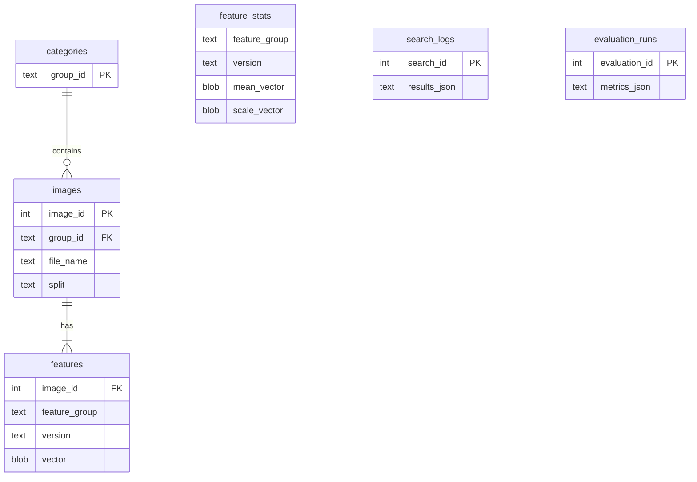

# Kiến trúc & thuật toán — giải thích từ dữ liệu đến kết quả

## 1. Mô hình hoạt động

```mermaid
flowchart TD
    A[ZIP ảnh lá thật] --> B[Importer: kiểm tra PNG / tên / hash]
    B --> C[Chia gallery / validation / test]
    C --> D[Preprocess HSV + mask 512×512]
    D --> E[Trích 4 vector 326 + 145 + 41 + 48]
    E --> F[(SQLite images + features)]
    F --> G[Tính mean / scale chỉ từ gallery]
    G --> H[(feature_stats)]
    J[Trình duyệt: tải ảnh truy vấn] --> K[FastAPI POST /api/search]
    K --> D2[Preprocess cùng phiên bản]
    D2 --> E2[Trích 560 chiều của query]
    F --> L[Chỉ đọc ảnh gallery]
    H --> M[RMS chuẩn hóa từng nhóm]
    E2 --> M
    L --> M
    M --> N[Trộn trọng số 25/45/15/15]
    N --> O[Top 5 ảnh theo D tăng]
    O --> J
    F --> P[Query validation / test]
    P --> Q[Đánh giá theo nhãn nhóm]
    Q --> R[Accuracy@1, P@5, MRR@5]
```

## 2. Tiền xử lý

Cho ảnh BGR đã đọc, chuyển HSV. Mỗi pixel được đánh dấu foreground khi:

```
(S > 33 AND V < 252) OR V < 155
```

Mở hình thái với kernel 3×3 để giảm điểm lẻ; đóng 7×7 để lấp lỗ hẹp. Lấy contour lớn nhất, crop vùng bao rồi resize sao cho cạnh dài 440 pixel trong canvas trắng 512×512, giữ nguyên tỉ lệ dài/rộng. Ảnh lá rất hẹp hoặc bị tách nhiều thành phần sẽ được đánh cờ, không khẳng định tự động rằng ảnh bị hỏng.

## 3. Đặc trưng 560 chiều

| Nhóm | Số chiều | Cụ thể | Công dụng |
| --- | ---: | --- | --- |
| Màu (`color`) | 326 | HSV256, Lab48, RGB moments12, Hue2, entropy3, ExG5 | So khác sắc độ và phân bố màu |
| Hình (`shape`) | 145 | Geometric12, turning angles54+15, Fourier64 | Hình dạng phiến lá, đường viền |
| Gờ (`ridge`) | 41 | Hessian24, skeleton8, orientation8, coherence1 | Đường gờ/vân **ứng viên** bên trong |
| Kết cấu (`texture`) | 48 | GLCM18, LBP30 | Quan hệ mức xám, biến thiên cục bộ |
| **Tổng** | **560** | **4 nhóm** | Tìm kiếm CBIR |

### Ý nghĩa của `numpy` và BLOB

Ảnh màu sau decode là ma trận 512×512×3. Mask là ma trận nhị phân 512×512. Mỗi module chuyển phần thông tin này thành vector `float32` 1 chiều, với số chiều cố định. Dữ liệu lưu vào SQLite bằng `vector.tobytes()` (float32 little-endian), lấy ra bằng `np.frombuffer(blob,dtype='<f4')`.

## 4. Chuẩn hóa và tìm kiếm

Với mỗi chiều `j` của đặc trưng `g`, importer tính **từ gallery**:

```
mu[g,j] = mean(feature_i[g,j] for i in gallery)
sigma[g,j] = std(feature_i[g,j] for i in gallery)
scale[g,j] = sigma[g,j] if sigma[g,j] > 1e-8 else 1
```

Khoảng cách giữa một query Q và một ảnh gallery I:

```
D_g(Q, I) = sqrt(mean(((F_g(Q) - F_g(I)) / scale_g) ** 2))
D(Q, I)   = 0.25*D_color + 0.45*D_shape + 0.15*D_ridge + 0.15*D_texture
```

- Trung bình bình phương **trong mỗi nhóm** giữ nhóm 326 chiều không tự động chi phối nhóm 41 chiều.
- Trọng số thay đổi được; backend chuẩn hóa tổng về 1.
- `np.argsort(..., kind='stable')` trả thứ hạng xác định trong trường hợp đồng điểm.
- Giá trị `D` **không phải xác suất nhận dạng lá**. Không đặt nhãn `95% là loài A`.

## 5. Sơ đồ ER tóm tắt



Ràng buộc UNIQUE với `file_name`, `sha256` và `pixel_sha256` giúp chặn bản sao chính xác. `feature_stats` liên kết theo **group + version** logic, không đặt khóa ngoại trực tiếp vì đây là bảng tổng hợp; hàm `feature_stats()` kiểm tra 4 nhóm, đúng số chiều và gallery_count.

## 6. Cách diễn giải metrics có trách nhiệm

- **Accuracy@1:** tỷ lệ query có top1 cùng mã nhóm.
- **Precision@5:** trung bình số ảnh cùng mã nhóm trong năm ảnh đầu chia cho 5.
- **MRR@5:** trung bình nghịch đảo vị trí đầu tiên có kết quả cùng nhóm, nếu không có = 0.
- **Rò rỉ near duplicate:** nếu cùng mẫu lá ở gallery và test (xoay/cắt/chỉnh sáng), metric có thể ảo. Dùng pHash hỗ trợ rà soát, không dùng test để chọn cấu hình.
- **Lớp ít mẫu:** nhóm 25 có thể chỉ 3 ảnh gallery, vì vậy P@5 tối đa 3/5 cho query nhóm 25 khi vẫn luôn trả 5 ảnh.

## 7. Giới hạn của thiết kế

Đây là hệ tìm kiếm ảnh tương đồng dựa trên đặc trưng thị giác. Nó **không** phải mô hình deep learning nhận diện loài, cũng không có chứng cứ về độ chính xác ngoài tập đã đo. Pipeline hiện thực theo đặc tả báo cáo, không tuyên bố có mã nguồn Python gốc chưa được đối chiếu. Khi muốn thay thuật toán hay vector, phải nâng `pipeline_version` và xây lại SQLite.

## 8. Bản v1.1 — dữ liệu thật và kiểm soát chất lượng

Dữ liệu thực đã được đóng gói vào `data/images` và `data/leafsearch.sqlite`; không phải là mock. Mỗi `images.image_id` liên kết tới đúng 4 BLOB `features` theo `version='leaf-v1-web-1.0'`.

- `backend/services/quality.py`: trả số ảnh cần duyệt mask, mẫu ảnh minh họa và thống kê nghi gần trùng pHash; không có audit thì trả các chỉ tiêu `null`.
- `backend/tools/verify_dataset.py`: chạy độc lập để xác minh byte/pixel SHA-256 và mean/scale gallery trước khi nộp bài.
- `backend/tools/evaluate_sensitivity.py`: thử độ nhạy bằng cách bỏ ứng viên gallery có pHash Hamming ≤6 với mỗi query; không thay đổi SQLite. Kết quả **không** thay thế phép đánh giá độc lập và không quyết định chắc chắn ảnh trùng.

Mọi kết luận về mức độ chính xác theo **mã nhóm hình thái** phải được đọc cùng với giới hạn ảnh gần trùng và nguồn ảnh không xác thực loài. Xem báo cáo định lượng `docs/REAL_DATASET_REPORT.md`.
